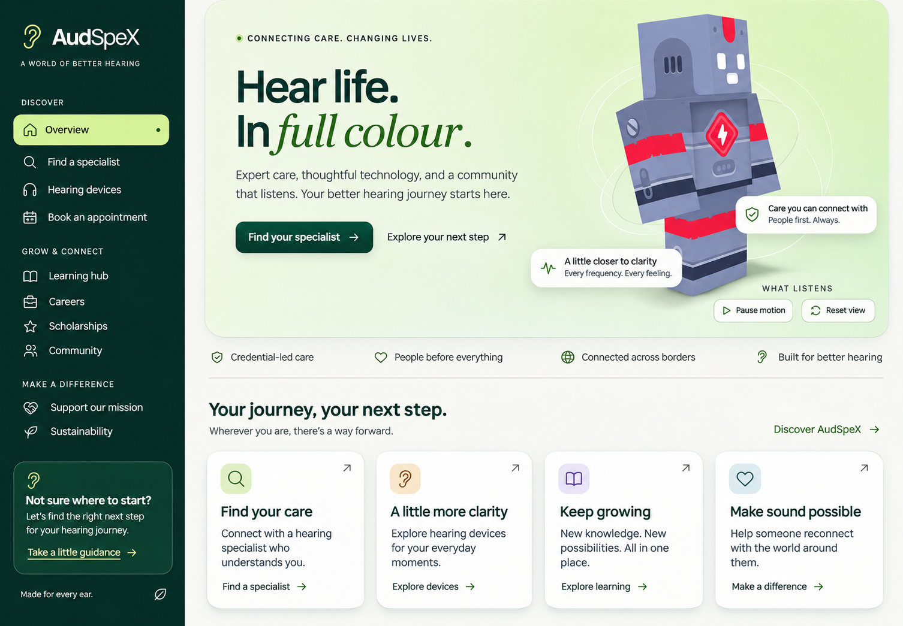
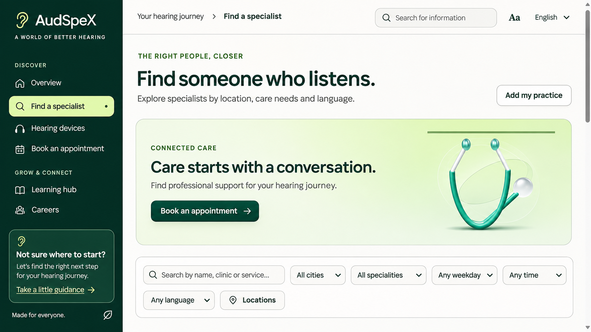
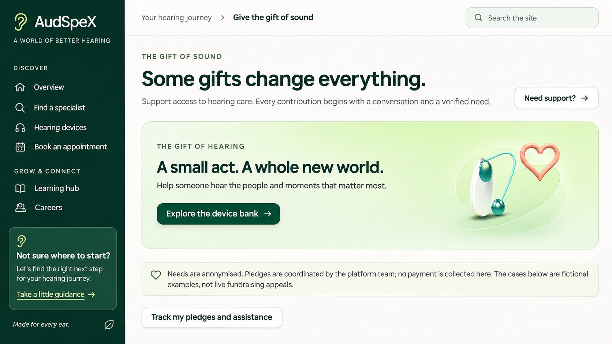
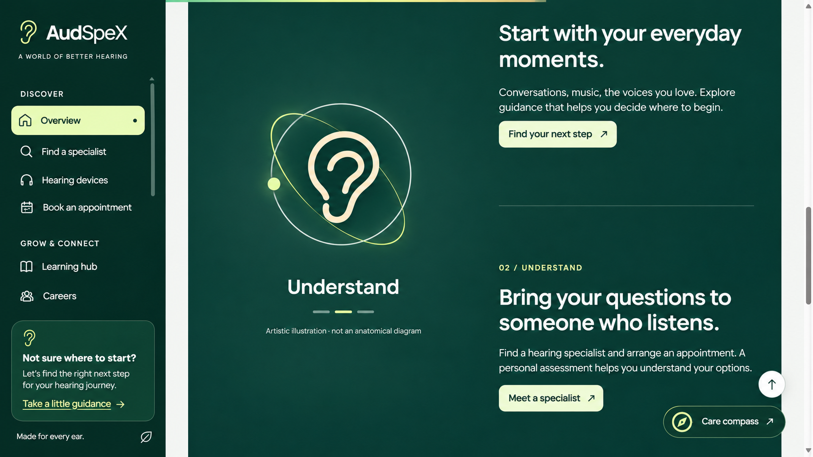
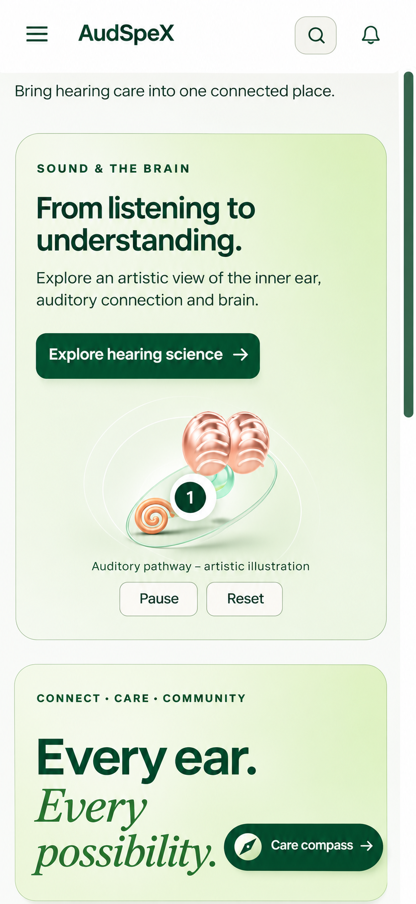

# AudSpeX

### A hearing healthcare platform built by MRX IT SOLUTIONS

[Visit AudSpeX](https://audspex.com/) · [Read the case study](audspex-case-study.pdf)

AudSpeX is a deployed audiology reporting platform for clinicians and patients. It brings PTA and tympanometry reports, custom layouts, and report access into a browser-based workspace.

## Explore the platform

- **PTA reporting** supports clinician-entered measurements and audiogram graphs.
- **Tympanometry reporting** brings middle-ear results into a customisable report.
- **Report design** offers clinic letterheads, graph settings and layouts.
- **Patient access** provides a way to find published reports using the clinic's identification details or the recorded contact information.
- **Learning and community** provide explanations, tutorials and discussion resources.

## Interface gallery

These enhanced illustrative reconstructions are based on earlier AudSpeX development views. The live reporting site has since evolved.

### Support and community

### The hearing journey

### Responsive design

## Building the experience

The local development project combines a browser frontend, a Node.js backend and persistent data storage. The live site provides separate journeys for clinicians and patients, including report review, publishing and print or PDF output.

The gallery illustrates earlier development versions and includes enhanced reconstructions. Visit the live site for its current interface.
